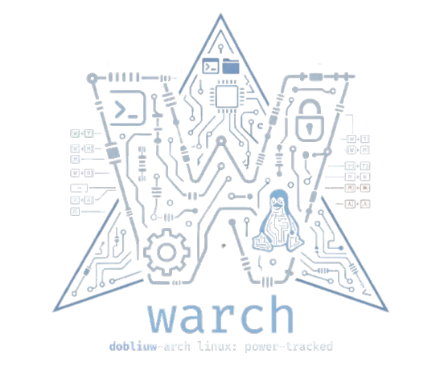

<p align="center">
  
</p>
<p align="center">
  <b>This is a <code>Dobliuw's</code> <bold>Arch linux</bold> configuration to use the entire system with a cool asthetic and aimed to bash usage with shortcuts.</b><br>
</p>

-------
# WArch

My Arch Linux + Hyprland desktop, reproducible. It's not a distro: it's a repo with the configuration
and an installer that turns any machine (laptop or PC, with one, two or three monitors) into the same
system: bar, shortcuts, themes, wallpapers, lock screen, VPN and tools.

## Install on a new machine

```sh
git clone <this repo> ~/warch && cd ~/warch
./install.sh            # asks about the optional parts (NordVPN, kitty, TO-DOsh)
./install.sh --yes      # all defaults, no questions
```

Then log into Hyprland and, if the monitors aren't arranged the way you want, run `warch setup`.

The installer is safe to run again. Anything already in `~/.config` is moved to
`~/.config/warch/backup/<date>` before linking. Individual steps: `./install.sh --only links,setup`.

| Step | What it does |
|---|---|
| `packages` | Installs everything below with pacman (+ `nvidia-utils` if there's an NVIDIA GPU; the driver itself is left alone) |
| `aur` | NordVPN (`nordvpn-bin`), installing `yay` if needed |
| `fonts` | Manrope from google/fonts (the AUR package is broken) |
| `links` | Links the repo config into `~/.config` and the CLI into `~/.local/bin`; copies the wallpapers |
| `services` | Disables dunst/mako, enables NTP and Bluetooth, sets the default theme |
| `todosh` | Clones TO-DOsh into `/opt/todosh` |
| `setup` | Generates this machine's own configuration (see below) |

## What handles what

| Piece | Tool | Where it's configured |
|---|---|---|
| Window manager, shortcuts | **Hyprland** (Lua config) | `config/hypr/hyprland.lua` |
| Bar, panels, launcher, notifications, lock screen, overview, cheat sheet, permission dialog | **Quickshell** (QML) | `quickshell/` |
| `SUPER + D` launcher (formerly wofi) | Quickshell: apps, and commands with `>` | `quickshell/drawers/Launcher.qml` |
| Notifications (formerly dunst) | Quickshell | `quickshell/services/Notifs.qml` |
| Wallpapers | **awww** | `warch wallpaper`, library in `~/.config/warch/wallpapers` |
| Idle lock | **hypridle** → `warch lock` | `config/hypr/hypridle.conf` |
| Night light | **hyprsunset** | `warch night` |
| VPN | **nordvpn** and **openvpn** (HTB) | settings panel, `~/.config/warch/vpn/htb.ovpn` |
| Terminal | **kitty** | `config/kitty/` |
| All of the above from the terminal | **`warch`** (bash) | `bin/warch` |

The interface follows the system language (`LANG`): English or Spanish (`quickshell/services/Tr.qml`).

## Per-machine configuration

The repo is the same on every machine. What changes lives outside it, in `~/.config/warch/`, and is
generated by `warch setup`:

- `machine.lua` — monitors (mode, position, rotation, scale), keyboard layout and whether there's an
  NVIDIA GPU. Loaded by `hyprland.lua`. Without this file, every monitor uses its preferred mode.
- `monitors.json` — which monitor gets the bar (`main`) and which gets the hidden side panel (`side`).
  If there's no vertical monitor, the panel goes on the main one.

`warch setup` captures Hyprland's current layout: arrange your monitors, run `warch setup` and it's
saved. On the first login on a new machine it runs automatically (`--auto`).

On small screens the bar compacts itself (no window title, then no date) and the panels shrink to fit
the monitor's width. On laptops the battery shows up.

## Main shortcuts

`SUPER + K` shows all of them (it reads `hyprctl binds`). The warch ones:

| Shortcut | Action |
|---|---|
| `SUPER + D` | Launcher (`>` for commands: scheme, wallpaper, variant, transparency…) |
| `SUPER + A` / `C` | Dashboard / quick settings and VPN |
| `ALT + Tab` | Workspace overview |
| `SUPER + W` | Wallpapers |
| `SUPER + Esc` / `L` | Session menu / lock |
| ``SUPER + ` `` | Side panel (calendar, TO-DOsh, notifications) |
| `SUPER + M` | Bar mode: system → pentest → study |
| `SUPER + I` / `SHIFT + I` | Copy target IP / LHOST |
| `SUPER + T` | Pomodoro |
| `SUPER + K` | Cheat sheet |

## CLI

```sh
warch setup [--auto]                 # this machine's monitors, keyboard and GPU
warch theme scheme neon              # grafito, circuito, islas, neon, bosque, ambar, wallpaper
warch theme mode light | variant vibrante | opacity 80
warch wallpaper set img.jpg [DP-2|all]
warch mode pentest                   # sistema | pentest | estudio | next | prev
warch target set 10.10.11.32 box     # target (switches to pentest mode)
warch pomo start | toggle            # 90/20 pomodoro (study mode)
warch lhost                          # copies your LHOST (tun* IP)
warch night toggle | warmer | cooler
warch lock [--test]                  # --test: preview without locking
warch ui dashboard|settings|launcher|wallpaper|overview|cheatsheet|session
warch shell restart | logs
```

## Layout

```
install.sh                installer
bin/warch                 CLI; writes its state to ~/.local/state/warch/
bin/warch-wallpaper       generates wallpapers (circuit + logo) sized for each monitor
bin/warch-palette         extracts a color palette from an image
config/hypr/              hyprland.lua, launch.sh, hypridle.conf, scripts/
config/kitty/             terminal
quickshell/               the shell: bar/, drawers/, overlays/, panel/, lock/, services/
wallpapers/               starting library (copied to ~/.config/warch/wallpapers)
```

## Updating

Since the config is linked to the repo: `git pull` and `warch shell restart` (plus `hyprctl reload`
if `hyprland.lua` changed).

## Notes

- The real lock screen only turns on after you've unlocked the preview (`warch lock --test`)
  successfully once, so you can't get locked out if something goes wrong with the keyboard.
- warch's permission dialog only appears for actions started from the interface; in the terminal,
  `sudo`, `systemctl` and `pkexec` keep asking for the password in the terminal.
- To go back to dunst: `systemctl --user unmask dunst`.
